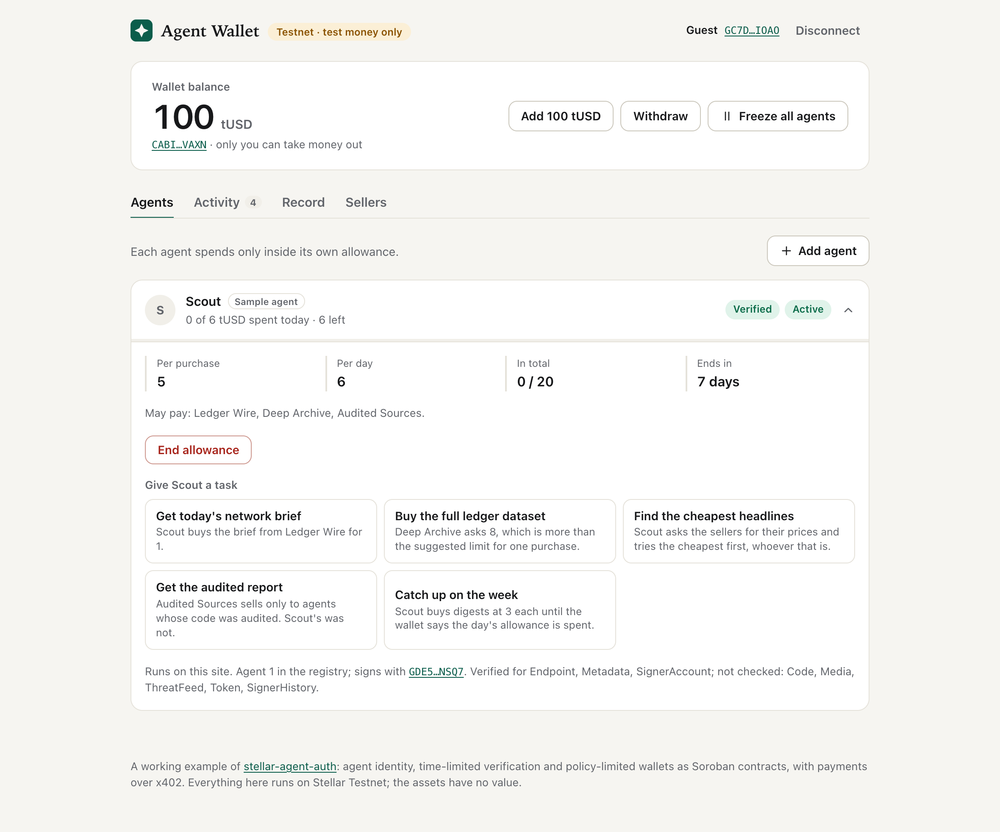
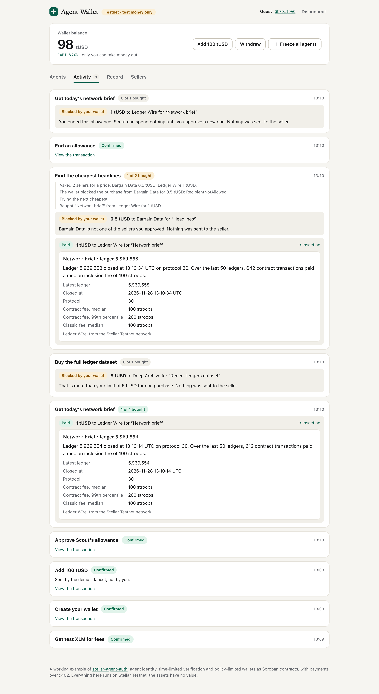
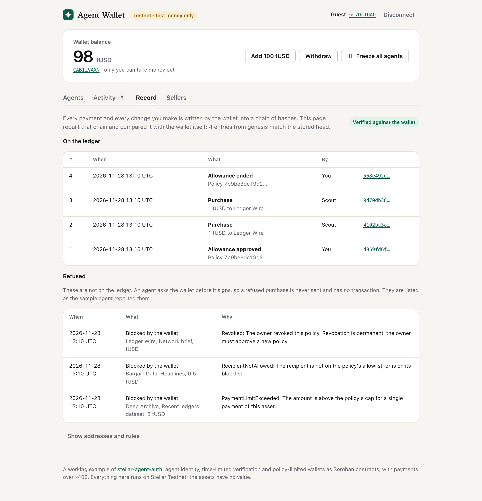

# Evidence of completion

This page is for whoever reviews the Instawards statement of work for Stellar Agent Auth. It lists, for each of the three deliverables, what was built and where to look. Every link goes to something that can be opened without installing anything.

Everything runs on Stellar Testnet. The money is a test asset, tUSD, issued for this project. It has no value.

| | |
| --- | --- |
| The demo | <https://stellar-agent-wallet.fly.dev/> ("Try as a guest" needs no wallet) |
| The code | <https://github.com/CenekSanzak/stellar-agent-auth> |
| Test results | [CI runs](https://github.com/CenekSanzak/stellar-agent-auth/actions/workflows/ci.yml); every change is tested before it is merged |
| Setup guide | [SETUP.md](SETUP.md) |
| A short video | To be added by the builder |

## Deliverable 1: a registry of agents and their checks

*A Stellar registry that records an agent, its signing account, and a time-limited check result from an approved verifier.*

Two contracts do this. The agent registry records each agent's signing account and who manages it. The verification registry records, for each agent, the latest result from an approved verifier, with the date it stops counting.

| | |
| --- | --- |
| Agent registry | [`CDQXY7OP…WBZLE63`](https://stellar.expert/explorer/testnet/contract/CDQXY7OPSHKQGEVCIJI6UITZPD7B7U2G7SJHK2TJNXTKSE4T5WBZLE63) |
| Verification registry | [`CDZDDHWQ…SRTV6RS`](https://stellar.expert/explorer/testnet/contract/CDZDDHWQNZBZ7JCI5THJGU76ZTAXUOB3BXIXMVZJFKQP2ZPJ3SRTV6RS) |
| The verifier was approved | [`aba47fa4…3795b1`](https://stellar.expert/explorer/testnet/tx/aba47fa4a4bfa844d26ed85a514a064099d4f8daacb6fe7aea5552ee863795b1) |
| An agent is registered | Agent 7, on 28 November 2026: [`186d5514…1edc10`](https://stellar.expert/explorer/testnet/tx/186d55143ed2b95b359e1fbbef3e1c15e7d369653e988af4ef00ff92971edc10) |
| Its check result is published | [`a7e522d6…3aaf29`](https://stellar.expert/explorer/testnet/tx/a7e522d6f52411480c3090234d0bd5c79c770b0f09c0d801762134b4233aaf29). It counts until 28 December 2026 |

**Screenshot.** The demo, showing the sample agent as verified, the checks behind that, and its allowance:

**What the verifier checked, and what it did not.** For agent 7 it confirmed that the agent's description is the one that was registered, and that its signing account exists on the network. It did not review the agent's code or anything else; the result says "unsupported" for those, and the wallet treats an unsupported check as not passed. The full list is in [verification coverage](VERIFICATION_COVERAGE.md).

**Tests for expired and invalid results.** These run automatically on every change; the latest results are in the CI runs linked above.

| What is tested | Where |
| --- | --- |
| A result stops counting at its expiry date, and when it is older than the wallet allows | `tests/integration/verification-flow.test.ts`: "denies a result at its expiry and beyond the maximum age, by ledger time" |
| A newer failed check replaces an earlier pass, and a revoked result stays revoked | the same file: "lets a newer failure replace a pass and makes revocation terminal" |
| Only an approved verifier can publish | the same file: "rejects publication by anyone other than an approved provider of the same mode" |
| A result stops counting when the agent's identity changes | the same file: "retires results and already signed publications when the identity changes" |
| A payment is refused when the result has expired | `contracts/smart-wallet`, in its own tests, and the `ResultExpired` reason in [the setup guide](SETUP.md#what-a-refusal-means) |

## Deliverable 2: a wallet the owner controls

*A Soroban smart wallet with payment limits, approved assets and recipients, an end date, pause, and revocation.*

Each owner has a wallet contract of their own. The owner puts money in and approves an allowance for one agent: how much per payment and per day, in which asset, to whom, and until when. The agent signs its payments with its own key. The wallet checks every payment against the allowance and against the agent's current check result, and refuses anything outside them.

On 28 November 2026 the scenario below was run on Testnet. The owner approved an allowance of **5 tUSD per payment and 20 per day, to one recipient, for seven days**. The wallet started with 100 tUSD.

| | What happened | On the ledger | Wallet balance |
| --- | --- | --- | --- |
| **Allowed** | The agent paid 3 tUSD to the approved recipient | Applied: [`c101e432…cec17a`](https://stellar.expert/explorer/testnet/tx/c101e432d08c292f5529ca5dae962670a7bc16165df71e17eabd5836a4cec17a) | 100 → 97 |
| **Blocked: over the limit** | The agent tried to pay 8 tUSD | Failed, `PaymentLimitExceeded`: [`57bccc1b…3186d5`](https://stellar.expert/explorer/testnet/tx/57bccc1bbb6f2fe24717c2f9b8d330dc770526380f7e1fef55feedb6c03186d5) | 97, unchanged |
| **Blocked: unknown recipient** | The agent tried to pay 3 tUSD to someone the owner had not approved | Failed, `RecipientNotAllowed`: [`4060ce3c…dc43e1`](https://stellar.expert/explorer/testnet/tx/4060ce3c027b8f2e97becb2d1571c9181d40294ec756544b8e44412547dc43e1) | 97, unchanged |
| Pause | The owner paused the wallet | Applied: [`34cc6408…81a864`](https://stellar.expert/explorer/testnet/tx/34cc64081a93d3048f6f3e26eeddc1b7775b7a902211888dead4a1fcb581a864) | |
| **Blocked: paused** | A payment the agent had signed before the pause was submitted | Failed, `Paused`: [`bccd4676…a3635b`](https://stellar.expert/explorer/testnet/tx/bccd467626f966e7cbf474cf8a2e5df059942c8a99ee9f930401fd38f0a3635b) | 97, unchanged |
| Resume | The owner resumed the wallet | Applied: [`14fae717…e8815b`](https://stellar.expert/explorer/testnet/tx/14fae7174ce45ea5e8b2a1675f9322b0dcb10d0d852e49cd44a67b2847e8815b) | |
| Revocation | The owner revoked the allowance | Applied: [`4535be2e…8657ba`](https://stellar.expert/explorer/testnet/tx/4535be2e3d4527e8a5d402ebf70917bba0168a059ea2b1ae47990741e78657ba) | |
| **Blocked: after revocation** | A payment the agent had signed before the revocation was submitted | Failed, `Revoked`: [`b946ce2e…9822a2`](https://stellar.expert/explorer/testnet/tx/b946ce2e00567c662902032d8f6ea9890b22e105481e282cb5cec1f4399822a2) | 97, unchanged |

The wallet is [`CDA6MY2C…3GXOENDV`](https://stellar.expert/explorer/testnet/contract/CDA6MY2C6LUDOEDURJ5TTRW4ERTMDT5ORGGHFGQIQSUOYYMZ3GXOENDV). It was created in [`6cf52834…38eb84`](https://stellar.expert/explorer/testnet/tx/6cf52834dfaeedde66617036c6670e82bfdbf1174a285e72070d9f017138eb84), funded in [`458fab8a…b26d83`](https://stellar.expert/explorer/testnet/tx/458fab8ab95196346fbebae5fa0970424e15e9e443accda80e874c4591b26d83), and the allowance was approved in [`bd0300c7…f61040`](https://stellar.expert/explorer/testnet/tx/bd0300c7b9f99338041be4a53cd0709256c6dfa321a14fd091375e9716f61040). At the end it held 97 tUSD, the allowance was revoked, and the wallet's own record of what happened was rebuilt and matched what the wallet stores.

**How to read a blocked payment.** A blocked payment shows in the explorer as a failed transaction: it was sent, the wallet contract refused it, and nothing moved. The reason is the wallet's own, read from the failed transaction. In normal use a blocked payment is never sent at all: the agent asks the wallet first and is told no. They were sent here so that there is something on the ledger to look at.

The whole run, with every address and transaction, is in [`deployments/testnet/evidence.json`](../deployments/testnet/evidence.json). Anyone can repeat it; see [the setup guide](SETUP.md#repeat-the-acceptance-run).

**The same cases in the demo.** A guest's wallet on the hosted demo, after the sample agent was given four errands: one purchase paid, one blocked for being over the limit, one blocked for an unapproved seller, and one blocked after the allowance was ended.

**A short video** of this in the demo is to be added by the builder.

## Deliverable 3: developer kit, demo, tests, deployment and guide

| | |
| --- | --- |
| Demo | <https://stellar-agent-wallet.fly.dev/>. Create a wallet, give an agent an allowance, and watch it pay and be refused. It works as a guest and with Freighter. Other Stellar wallets can be picked from a list; none of those was tried |
| Your own AI agent | Someone's own agent in Claude Code, Codex or another MCP host can be the wallet's agent. The page gives one sentence to paste into it. The tool it installs is the npm package [`stellar-agent-wallet`](https://www.npmjs.com/package/stellar-agent-wallet) |
| Developer kit | A TypeScript SDK (`packages/sdk`), a command-line tool (`packages/cli`), a package for paying web APIs over x402 (`packages/x402`), and the agent tool (`packages/mcp`). Each has a README |
| Tests | Unit tests, contract tests, tests on a local Stellar network with real signatures, and a browser test of the demo. All run in CI on every change. Counts and results are in [P8 validation](P8_VALIDATION.md) |
| Testnet deployment | The contract IDs above, the test asset and every role's public address are in [`deployments/testnet/manifest.json`](../deployments/testnet/manifest.json), with the transactions that made them. A script checks the record against the network: all 11 checks passed on 28 November 2026 |
| Setup guide | [SETUP.md](SETUP.md): try it, connect your own agent, run it on your machine, use the SDK, deploy your own. [OPERATIONS.md](OPERATIONS.md) covers who holds which key, upkeep and limits |

The wallet's record in the demo, rebuilt from the ledger and checked against the wallet:

## What is not included

The statement of work excludes three things, and they are not claimed here:

- **A security audit.** Nobody outside the project has reviewed the contracts. Do not put real money behind them.
- **Every feature of ERC-8126 and ERC-8196.** The verifier performs three of ERC-8126's checks and reports the rest as unsupported. [ERC compatibility](erc-compatibility.md) lists what was adapted and what was left out.
- **A general consumer wallet.** The wallet pays in assets and to recipients the owner approved. It does not call arbitrary contracts.

Three limits a reviewer should know:

- The asset is a test asset. Nothing here was run on Stellar's public network.
- A web API that settles payments with the published x402 software, unchanged, refuses this wallet as a payer. The demo's sellers use this project's own settlement and accept it. Three outside sellers were tried on 27 November 2026 and all refused it; see [x402 validation](X402_VALIDATION.md).
- The demo is one small server. If it is down, the contracts and every wallet are still on Testnet, and the acceptance run can be repeated against a server anyone starts.
